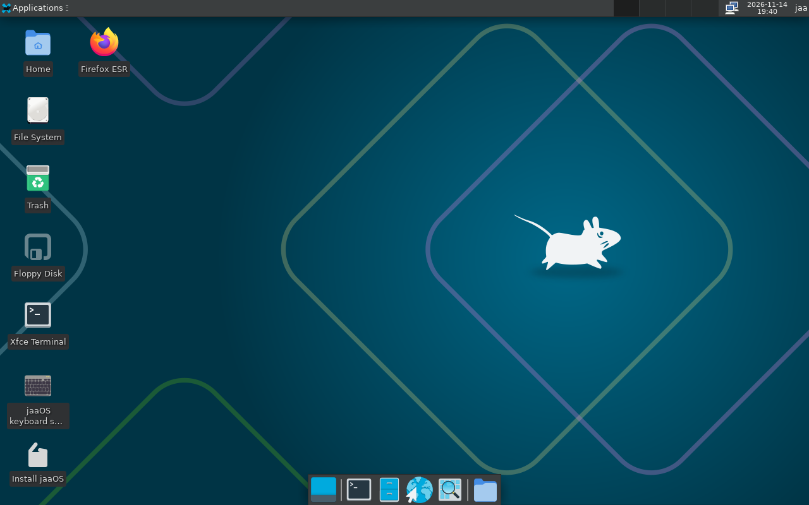

# jaaOS — desktop edition (XFCE)

A graphical jaaOS. It is the lite live ISO plus an XFCE desktop, so everything from the console
edition is still there: Docker, RKE2 + `jaa-cluster`, the installer and the shell shortcuts.

| | Lite ISO (`make live`) | Desktop ISO (`make live-desktop`) |
|---|---|---|
| File | `out/jaaos-lite.iso` | `out/jaaos-desktop.iso` |
| Size | ~310 MB | ~530 MB |
| Session | console | XFCE on X11, LightDM login screen |
| Live login | `jaa` / `jaa`, password change forced | logs in **automatically** as `jaa` (password `jaa` for sudo) |
| Sound / webcams | drivers trimmed | kept (PipeWire + pavucontrol) |

```bash
make live-desktop
make live-desktop-test
bash tests/vm/live-desktop-screenshot.sh
```

The third command boots the ISO in QEMU and saves the screen to `out/desktop-screenshot.png`.



*The live desktop as booted in QEMU by `tests/vm/live-desktop-screenshot.sh`. "Floppy Disk" is
QEMU's emulated drive.*

## What is in it

`build/profiles/desktop-xfce.packages`, all from Debian main:
- Xorg (modesetting, plus fbdev/vesa for "safe graphics"), LightDM + GTK greeter.
- XFCE: panel, Whisker menu, Thunar (+ archives, removable media), terminal, Mousepad,
  Ristretto, task manager, screenshots, notifications, screen locker, power manager.
- NetworkManager applet (Wi-Fi/VPN), PipeWire sound, polkit agent (so the applet and Thunar can
  ask for your password).
- Firefox ESR.
- `spice-vdagent` (clipboard + automatic resize in VMs).
- Look: Greybird-dark theme, Adwaita icons, DejaVu fonts. These are the defaults for new users
  (`config/rootfs/etc/xdg/xfce4/xfconf/`), and each user can change them.

The live desktop has **Install jaaOS** (runs `sudo jaa-install` in a terminal) and
**jaaOS keyboard shortcuts** (`jaa-keys`) on the desktop and in the menu.

## Installing it

`sudo jaa-install` offers the profile **desktop-xfce**: the same desktop on an encrypted disk,
with the LightDM login screen (no auto-login) and the account you create. The GNOME profile
(`desktop`, Wayland) is still there for people who prefer it.

## Why XFCE (and the trade-off)

XFCE is about a third of GNOME's size and stays usable in VMs without GPU acceleration. The cost
is **X11**: unlike Wayland, X11 lets any graphical program read other windows and keystrokes. On
this desktop, an untrusted GUI program can snoop on the others. If that matters for your threat
model, install the GNOME/Wayland profile, or run untrusted GUI apps in a separate VM.

## Limits (honest)

- **Booted in QEMU only** (software emulation), not on real hardware.
- Like the lite ISO, it needs **Secure Boot off**.
- Wi-Fi on real laptops needs `FIRMWARE=1` (`make live-desktop FIRMWARE=1`).
- The live session's password `jaa` is public and **not forced to change**: auto-login cannot
  handle a forced change. That is fine for a throw-away live session (SSH accepts keys only, and
  nothing is kept after a reboot), but do not run the live system on an untrusted network as
  if it were installed.
- No Bluetooth manager yet (BlueZ is not in the lite base).
