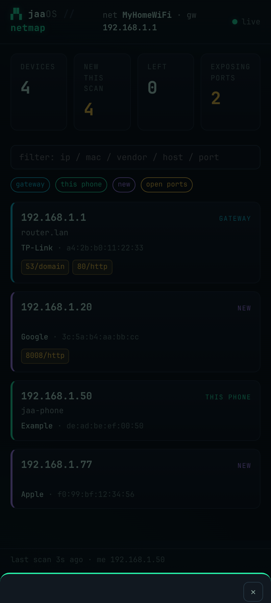

# jaaOS Mobile — network visibility & management (`jaa-net`)

Once your phone is on a WiFi network **you are authorized to manage** (your home/office network),
`jaa-net` gives you an administrator's view of it: every device, what each one exposes, who joins
and leaves, and a dashboard with a DevOps/hacker look. Same contract as `jaa-scan`/`jaa-wifi`:
**authorized networks only, scope-enforced, every run audited.** It reuses your
`wifi-engagement.conf`.



*The dashboard (`jaa-net serve`), rendered in a browser at phone width. Gateway, this phone, and
newly-joined devices are colour-coded; tapping a device opens its detail + the legitimate block path.*

## What it can and cannot do (read this first)

jaaOS will not pretend a phone can do things it cannot, and will not ship attacks.

| You want | `jaa-net` | Honest reason |
|---|---|---|
| See every device on the network | **Yes** — `jaa-net map` (IP, MAC, vendor, hostname, open ports) | ARP + ping discovery; this is what an admin's scanner does |
| Know when a device joins/leaves | **Yes** — `jaa-net watch` (alerts via `jaa-alert`/ntfy) | compares each scan to the last |
| See what services a device runs | **Yes** — `jaa-net device <ip>` (ports, service/version) | `nmap -sV` of an in-scope device |
| A live dashboard to visualize it all | **Yes** — `jaa-net serve` (local web UI, hacker theme) | served on `127.0.0.1`, viewable on the phone or over an SSH tunnel |
| See the **contents** of other devices' traffic | **No** | on WiFi that needs ARP-spoofing/MITM — intercepting others' traffic is wiretapping and an attack jaaOS does not do. You only see your own device's traffic (use PCAPdroid) |
| **Block / kick** another device | **The admin way** — `jaa-net block` drives your **router's** controls | as a WiFi *client* the only other way to block a device is ARP-spoofing it (the NetCut/WiFiKill method), which is a denial-of-service attack on that device. jaaOS ships no DoS tooling |

If you are doing **authorized** active testing of your own network (capturing a handshake, WPS,
etc.), that path needs an external USB adapter and bring-your-own tools — see
`docs/12-mobile-build.md` §"Active WiFi testing". `jaa-net` itself stays assessment + legitimate
admin only.

## Setup

`jaa-net` is installed by the toolkit (`jaa-devsec-setup.sh`) and needs `nmap`, `python`, `jq`
(all in the toolkit) and Termux:API with the **Location** permission (Android requires it for
WiFi info). It uses the engagement file from `jaa-wifi`:

```bash
jaa-wifi engagement init
```

In `wifi-engagement.conf`, list the networks you administer under `SCOPE_SSIDS` (and optionally
`SCOPE_SUBNETS=192.168.1.0/24`). `jaa-net` refuses to scan any network not listed.

## Commands

```bash
jaa-net map
```
Lists every device on the current network, marking the gateway (`[GW]`), this phone (`[ME]`) and
anything new since the last scan (`[NEW]`), with vendor and open ports. `--json` prints the raw
data.

```bash
jaa-net watch --interval 60
```
Keeps scanning and prints (and pushes a `jaa-alert`) whenever a device joins or leaves — "someone
new is on my WiFi".

```bash
jaa-net device 192.168.1.20
```
Full service/version scan of one device on the authorized subnet.

```bash
jaa-net serve
```
Starts the **dashboard** at `http://127.0.0.1:8088` — open it in the phone's browser, or from a
laptop through an SSH tunnel:

```bash
PHONE=192.168.1.50   # your phone's WiFi IP — jaa-net map shows it as the [ME] device
ssh -p 8022 -L 8088:127.0.0.1:8088 "$PHONE"
```

then open `http://localhost:8088`. It live-updates, lets you filter by ip/mac/vendor/host/port,
and opens a detail sheet per device (ports, services, first/last seen, and the block panel).

```bash
jaa-net block 192.168.1.20
```
Shows exactly how to block that device **through your router** (opens `http://<gateway>`, points
you to MAC filtering / access control, prints the MAC). It never attacks the device.

## Blocking devices — the honest guide

You can only legitimately block a device from WiFi if you control the network, and the control
lives in the **router**, not the phone:

1. `jaa-net block <ip>` (or the dashboard's block panel) gives you the device's MAC and your
   router's admin URL.
2. Open the router admin page, sign in (change the default admin password if you never have).
3. Find **Access control / MAC filtering / Device management**, add the MAC to the block list, save.
4. Many routers also offer "pause internet" per device and scheduling.

If you run a managed network (UniFi, OpenWrt, a captive portal), use that controller's own block
function. `jaa-net` never stores router credentials and never ARP-spoofs.

## The dashboard look

Dark terminal theme, monospace, neon-green/cyan accents, subtle scanlines — a DevOps/hacker feel
that also works in daylight (it respects a light-theme preference). The whole UI is three static
files (`mobile/net/dashboard/{index.html,app.js,style.css}`), no frameworks and no external
network calls; `jaa-net serve` just writes `data.json` next to them and serves the folder on
localhost. Every value from the scan is HTML-escaped before it reaches the page.

## Test results

- `tests/vm/mobile-net-test.sh` (25 checks, in `make test` + CI): device discovery, vendor
  resolution, join/leave detection, the authorization/scope gate (refuses an out-of-scope network,
  authorizes by SSID or subnet), per-device subnet scope, `block` = router-admin path (and its
  explicit refusal to ARP-spoof), no attack binary invoked, and that the dashboard is
  self-contained and escapes its input.
- The **dashboard was rendered in Chromium** at phone width (412×915) against sample scan data:
  4 device cards, correct stats, the detail sheet with ports + the router-block panel, **no
  console errors** (screenshots: `docs/img/netmap.png`, `docs/img/netmap-device.png`).
- **Not tested on a phone:** the live `nmap`/ARP scan of a real LAN, Termux:API WiFi info,
  alerts, and the SSH-tunnelled dashboard. The scan→JSON→UI pipeline was tested with canned data.
